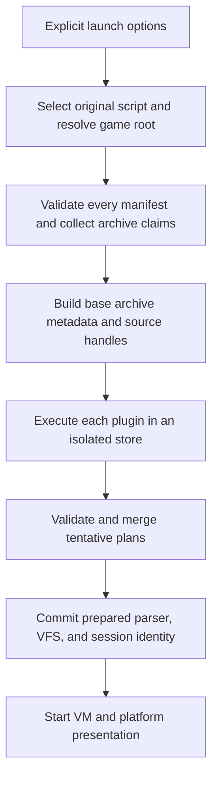

# RFC 001: desktop preparation plugins

Status: formal implementation proposal. Architecture decisions below are the baseline for implementation; ABI 1.0 remains a candidate until the release gates pass. This document does not claim that RFVP already loads plugins or that Windows/Linux have been tested.

Source baseline: `main` at `ffc7380`; Sakura reference: `sakura-moyu-patch-loader` at `8f6458f`. The [research plan](PLUGIN-SYSTEM-PLAN.md) records the source comparison. The [ABI specification](PLUGIN-ABI-V1.md), [prototype report](PLUGIN-PROTOTYPE-RESULTS.md), and [implementation checklist](PLUGIN-IMPLEMENTATION.md) accompany this RFC.

**Problem and outcome**

Supporting the Sakura Moyu Chinese patch currently requires game-specific code in RFVP startup, parser, VM, and VFS. The first plugin release will allow a desktop RFVP executable to load a separately built package that supplies translated script strings and replacement resources. Adding another package using these two capabilities will not require recompiling RFVP.

The plugin prepares immutable data before the VM starts. RFVP owns the installed tables and archive sources and performs ordinary string lookup and streaming afterward. No guest execution is needed for rendering, audio reads, or each line of dialogue.

**Scope and decisions**

| Area | Decision |
| --- | --- |
| Release targets | Desktop macOS, Windows, and Linux. GPU CLI, desktop library/pump APIs, and software-render desktop host share preparation. Each target needs its own release checks. |
| External execution | WebAssembly core modules interpreted by Wasmi. The prototype pins Wasmi 2.0.0 with validation, standard library, and portable dispatch; no WASI, JIT, or native-library plugin backend in version 1. |
| Guest/host interface | Four bounded imports and two function exports, with JSON context/output records. The external ABI is independent of Rust and of engine types. |
| Capabilities | `script-string-table-v1` and `resource-mapping-v1`. Resources map logical paths to entries in claimed standard FVP archives. Arbitrary byte-resource output is deferred to keep ownership and streaming semantics small. |
| Activation | Repeatable explicit `--plugin PACKAGE_DIRECTORY`, in supplied order. No directory scanning or automatic execution. |
| Compatibility | Plugins disabled preserve main's behavior. Sakura enabled preserves the reference branch's string substitution and archive matching, with added explicit validation failures. |
| Runtime state | None in the guest after preparation. Drop the interpreter after copying and validating output; retain host-owned sources for the game session. |
| Other hosts | Browser/mobile/UEFI/console builds must remain functional with the backend disabled. Their dynamic loading support is outside this release. |
| Extensibility | New capabilities require a later versioned contract. Custom syscalls, script preprocessing, font registration, runtime resource callbacks, and hot reload are deferred. |

Wasmi is selected for the desktop implementation because the standalone experiment loaded two independently built Rust/Wasm modules through the same unchanged host binary, returned usable tables, contained failures, and stayed within the experimental budgets. This establishes feasibility of the boundary. It does not establish full Sakura compatibility, large-archive performance, or portability to every advertised release target.

The measured 10,000-record case exceeded the first 100-million-fuel budget. The candidate host policy was one billion fuel units per plugin initialization. Authorized Sakura data then required about 3.69 billion, so the candidate is now ten billion. A tight loop needs about 19 s on an Apple M2 Pro to exhaust that budget. See the ABI's candidate revision note. Fuel accounting depends on Wasmi's version and is not a wall-clock deadline. Dependencies and features must be pinned and rebenchmarked when upgraded.

**Preparation architecture**



Preparation is all-or-nothing across the plugin list. Each plugin has a fresh store and fuel budget. A valid plan from an earlier plugin remains tentative until every plugin succeeds. An error releases tentative handles/data and returns a launch error without starting the VM.

Archive claims are declared in manifests, rather than discovered as a side effect of plugin execution. Collect the union of claims before building the original-archive metadata view. This resolves the circularity in the preliminary plan: a plugin can match against a stable original view even when later plugins claim additional archives. Two plugins claiming the same archive fail before execution.

Each manifest declares the game-relative input files it needs. The host opens them through a bounded source service, computes SHA-256 digests using streaming reads, assigns deterministic per-plugin handles in manifest input order, and supplies archive entry metadata for claimed archives. The source service bypasses overlays. Source handles remain private to one plugin during preparation. A committed resource mapping becomes a reference to a host-owned archive source, never a guest-memory address.

The engine must obtain metadata from actual selected files and its archive parser. The prototype accepts prebuilt fixture metadata and is deliberately not a replacement for those engine adapters. Large archives must remain seekable file sources in production; the prototype's small source byte vectors are not an implementation recommendation.

A source is considered immutable for the session. Plugin hot replacement or external editing of game/patch files during a session is unsupported. Keep source file handles stable where the platform permits; report subsequent I/O failures rather than falling back to an original resource. The profile digest describes the bytes observed during preparation, not a tamper-proof filesystem snapshot.

**Engine integration**

Create a portable API crate for contract types and plan validation, a game-specific Sakura crate, an optional Wasmi adapter, and an RFVP preparation module. Dependencies point from plugins to the API, never to the engine. The portable types may use `alloc`; Wasmi and manifest-file loading stay outside the `no_std` core. Static adapters can construct the same plans without a Wasm runtime.

Provide internal `LaunchOptions`, `PreparedGame`, and `PluginSession` types. `PreparedGame` owns the prepared parser, VFS, and session identity; presentation builders consume it. Names are internal and not part of the external ABI. Wire both the binary's separately declared engine modules and the library surface.

Do not trigger another `Vfs::default()` scan while constructing a prepared game. `GameData::Default` and `init_default_in_place` must remain consistent if fields or construction paths change. Initialization failures must be returned as launch errors before VM startup.

Keep source discovery behavior unchanged: desktop GPU startup already prefers `.bch`, whereas software/browser paths differ. Plugins operate on the selected script and cannot replace it in ABI 1.0. Resolve the game root before locating plugin input files. Do not add process-global environment variables for plugin options.

Retain existing C entry-point signatures. New versioned creation functions accept an explicit options JSON payload or an equivalent length-delimited options structure; the exact launcher ABI is an implementation detail separate from the guest ABI. Legacy functions delegate with an empty plugin list. CLI and launchers must call the same preparation service.

**Script semantics**

Generic replacements are indexed by the first byte of an HCB string payload, within the selected script's code area. Attach the immutable table independently of compression features. At `push_string`, retain original decoding and bounds behavior, then replace the decoded text when a mapping exists. Advance the cursor by the original byte length and push `ConstString(replacement, original_address)`.

Do not intercept `read_cstring` globally: it also decodes titles and syscall names. Do not change script NLS because a translation source happens to use GBK. The engine's existing text-length limits and font selection remain in effect.

Preparation validates range, duplicates, UTF-8, NUL exclusion, and output limits. Range validation alone does not prove that an offset is an instruction's string operand. Script-hash binding and plugin fixtures provide the first defense against a wrong offset; exact instruction-boundary validation is a possible later validator and must not be claimed by version 1.

**Resource semantics and ordering**

Retain logical loose-file overrides ahead of plugin mappings and original archives. Native main performs both a requested-path loose lookup and a folder-normalized lookup in `VfsFile`. The generic resolver must preserve those effective loose-file opportunities before selecting a plugin mapping. Add mixed-case folder tests so this does not become an accidental behavior change. This deliberately corrects one reference-branch edge case: its overlay can intercept a mixed-case folder request before the second loose lookup. Main's loose-file precedence takes priority for that case; document it in migration notes rather than claiming exact patch-branch equivalence there.

Canonicalize only the archive folder component to ASCII lowercase for mapping lookup. Preserve entry-name case and Unicode bytes. Duplicate mappings use this canonical key. A mapping opens the raw entry in its source archive and must not resolve `patch/<entry>` loose files. Plugin sources are not recursively resolved through other plugins.

Across plugins, later activation wins a duplicate string offset/resource key, and the host reports both IDs. Duplicate records within one plan are errors. Duplicate plugin IDs are errors. Claims and original metadata do not depend on installed mapping order. Unmatched/ambiguous Sakura entries remain skipped according to the plugin's own policy.

Version 1 does not expose resource callbacks. The committed VFS mappings reuse seekable archive slices for graphics, audio, and movie consumers. A failed mapped-source read is an error; it does not silently select an original asset.

**Sakura migration and game identity**

Move `patch.dat` parsing and unique-name matching into the Sakura implementation. The host supplies ordinary archive operations and generic replacements. Preserve GBK decoding, one trailing NUL removal, duplicate-offset rejection, and required-file behavior; add bounded decompression. Do not invent a header signature without verifying the first eight bytes' meaning.

Retain `--sakura-moyu-chs-patch` as an alias for a bundled implementation of the same plan contract. Deduplicate alias plus explicit activation of that plugin. During migration the bundled alias may accept an unlisted script hash with a visible unverified-identity diagnostic, matching today's broader activation. The session identity still includes the exact selected script and input digests.

External ABI 1.0 packages require an explicit supported-script hash list. They have no wildcard or force option. Verified Sakura script identities and a real-game smoke test are release gates, not values to guess or copy from proprietary data into the repository. Hashes may be recorded; game contents may not.

A statically bundled plugin records a build-generated digest of its implementation artifact/source inputs in session identity instead of a guest module digest. Changing implementation or patch inputs deliberately invalidates known save profiles even if the package version string stays unchanged.

**Save compatibility decision**

Include profile identity in new resumable saves before shipping external plugins. Reject known mismatches before any globals, scene state, audio, or VM state are applied. Older saves with no identity remain loadable with an explicit unknown-profile diagnostic. Do not attempt to retranslate serialized strings or promise safety across profiles.

Keep `SaveStateSnapshotV1` and the final `RFVS` footer unchanged. Insert a bounded metadata block immediately before the existing V1 state payload:

```text
legacy header/thumbnail | metadata JSON | u32 metadata_len | RFPM
                       | existing bincode V1 state | u32 state_len | RFVS
```

All lengths are little-endian byte lengths. Existing V1 decoding locates only its own trailing state slice, so the metadata is outside bincode's strict payload. The new decoder first locates the V1 payload start, then probes the preceding eight bytes for `RFPM`. When present, require a complete metadata block of at most 64 KiB; reject malformed, unsupported, or conflicting metadata. A missing marker means unknown identity. Metadata removal is not a security boundary.

Metadata schema 1 contains the script digest, source NLS, ordered plugin IDs/versions/implementation digests, and each plugin's ordered input paths/digests. Compare these typed values exactly. Compute a profile digest with the byte encoding specified in the ABI document. New resumable saves also record an empty plugin list when plugins are disabled, allowing future hosts to detect loading a plugin save without the plugin.

Old RFVP releases will ignore this metadata and cannot enforce the policy. Forward enforcement in old binaries is not promised. Integration tests cover slot metadata and thumbnail readers, both save-write paths, and legacy restoration. A cross-revision runner checks both directions against unchanged main: the new host restores a save written by main, and main reads a profiled save from the new host. Hosts that cannot activate plugins write no metadata and behave like old releases. Preserve non-resumable legacy saves unchanged when no RFVS state exists.

Move compatibility preflight to the beginning of load handling, before any existing legacy load mutations. On rejection, leave the running session unchanged and report the mismatch. A decode error must not fall through to an incompatible legacy restore path.

**Limits and failure behavior**

The candidate ABI specifies manifest/module/context/output sizes, guest memory, host-copy quotas, and registration counts. Missing inputs, incompatible API, unknown capability, wrong script hash, invalid output, module traps, fuel exhaustion, and source errors are fatal for an explicitly enabled plugin. Every diagnostic includes plugin ID and stage. Host-call violations trap immediately; a plugin cannot ignore a negative status and commit partial data.

Execution fuel does not bound compilation, filesystem latency, JSON validation, or other host work. Bound those by module/context/output sizes, finite import operations, aggregate copy quotas, and streaming source reads. Version 1 does not guarantee a real-time startup deadline. Wasmi's memory cap limits linear memory, not total host RSS.

Initial experimental targets on the measured Apple Silicon development host are: at most 2 MiB loader executable delta, under 250 ms median preparation for the 10,000-record synthetic fixture, and under 64 MiB peak process RSS for that fixture. These are regression budgets for the experiment, not minimum hardware requirements or full-game guarantees. Each release platform must record its own results; representative Sakura data must fit the candidate limits or the policy must be revised before publication.

**Acceptance and implementation status**

The standalone boundary, engine integration, real patch execution inside Wasm, multi-plugin session commit, streamed input hashing, and profile-aware saves are implemented. They are tested on synthetic data and, for Sakura, on authorized local data. Every string instruction and every archive resource matches the reference implementation on macOS arm64 and on Linux arm64 and x86_64 containers. A macOS gameplay smoke test passed. Two engine glyph-fallback defects found during the smoke test are fixed separately on top of main (`71076b4`). Windows x86_64 and ARM64 pass builds, tests, and synthetic conformance in CI. Windows real-data and gameplay checks and the ABI freeze remain open. The [checklist](PLUGIN-IMPLEMENTATION.md) makes these gates explicit.

Freeze ABI 1.0 only after an independently packaged Sakura plugin reproduces reference behavior on authorized local data, Windows/Linux/macOS validation passes, and save compatibility tests pass. A runtime upgrade or new capability requires review of the contract and evidence; it must not silently change published plugin behavior.
